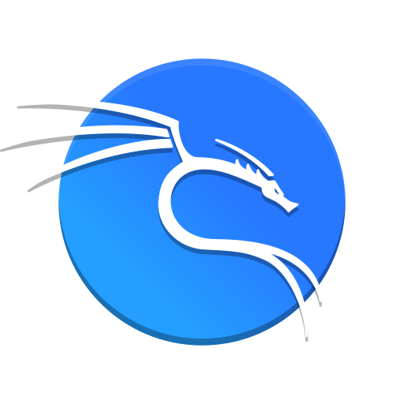
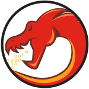

# Hello there !! I am Keith Lim 👋🐧

 
I am an Electronics Enthusiast and Hobbyist and I love all things electronics. ⚡️💥🛠️

I started my Electronics journey when I was in my Diploma days. From dismantling electic steamer
to custom designing my own PCB. I like to do projects that resonate with my interest and or it is just plain cool!

Now, I'm continuing my journey in Univeriti Teknologi Malaysia (UTM) @Skudai, studying Bachelors in Electronics Engineering with Electronic System Design Major.

My repo consists of the projects I've built from the past. Such as Computer Vision on posture, C++ calculator and an ESP32 controller Bluetooth car.
The project that I am most proud of is Price Catcher. Check it out [here.](https://github.com/bropenguin847/Price_Catcher)

## 🛠️ Tools

<!--  -->

<!--  -->
<!--  -->
<!--  -->
<!--  -->

 
 

## 💡 Future Ideas
In the future,  I would like to decorate my profile with my own personal website.

Here are a few of my upcoming projects:
- Open Source IC Design projects
- Personal Website / Web Resume with Python (Self Host)
  (HTTP methods and APIs, Request module, simple website with Flask, django & fastAPI)
- Portable Power supply with casing
- Hexapod
- Automating with Python

<picture>
  <source media="(prefers-color-scheme: dark)" srcset="https://raw.githubusercontent.com/bropenguin847/bropenguin847/output/github-contribution-grid-snake-dark.svg">
  <source media="(prefers-color-scheme: light)" srcset="https://raw.githubusercontent.com/bropenguin847/bropenguin847/output/github-contribution-grid-snake.svg">
  
</picture>

## 🔭 Current Projects:
[PCB Business Card V2](https://github.com/bropenguin847/PCB_Business_Card)

## 📫 Let's Connect!

 
 
 
Feel free to check out my projects, drop suggestions, or say hi!  
I'm always excited to grow and learn more. 🌱

---
### Daily XKCD
<!-- XKCD_START -->

<!-- XKCD_END -->

<!--
**bropenguin847/bropenguin847** is a ✨ _special_ ✨ repository because its `README.md` (this file) appears on your GitHub profile.

Here are some ideas to get you started:

- 🌱 I’m currently learning ...
- 👯 I’m looking to collaborate on ...
- 🤔 I’m looking for help with ...
- 💬 Ask me about ...
- 📫 How to reach me: ...
- 😄 Pronouns: ...
- ⚡ Fun fact: ...
-->
